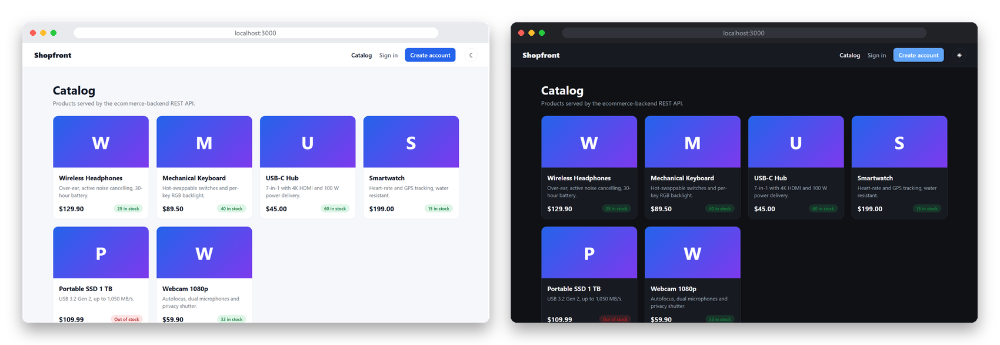
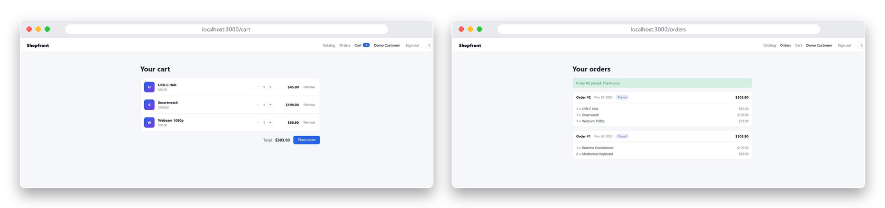

# E-commerce Frontend 🛍️

**Shopfront**, the web client of an online store built with **React** and **React Router**. Customers browse the
catalog, create an account, fill a cart and place orders against the
[ecommerce-backend](https://github.com/CuencaOscar/ecommerce-backend) REST API.






## Features

- **Catalog** loaded from the API, with loading skeletons, error + retry and empty states.
- **Accounts:** sign-up and sign-in against the backend with JWT; the session is restored on reload and the access
  token is refreshed automatically when it expires.
- **Cart:** add products from the catalog, change quantities within the available stock, remove items; the cart
  lives on the server, so it follows the user across devices.
- **Checkout and order history** with a confirmation message after placing an order.
- Protected routes (`/cart`, `/orders`) that send the user to sign in and back.
- Light/dark theme that follows the system preference, with a manual toggle.
- Environment-specific configuration through `.env.development`, `.env.test` and `.env.production`
  (`REACT_APP_API_URL`).

## Getting started

Requirements: Node.js 18+ and a running [ecommerce-backend](https://github.com/CuencaOscar/ecommerce-backend)
(`REACT_APP_API_URL` in `.env.development` points to `http://localhost:8000/api`).

```bash
npm install
npm start          # http://localhost:3000
npm run build      # production build
npm test           # Jest + React Testing Library
```

Tests cover the API client (token refresh and error messages), the product card and the cart. CI runs them and a
production build on every push.

## Project structure

```
src/
├── components/    # Button, ProductCard
├── context/       # ThemeContext, AuthContext (JWT session), CartContext (server cart)
├── hooks/         # useProducts
├── pages/         # Home (catalog), SignIn, SignUp, Cart, Orders
├── services/      # API client with token refresh, products
├── utils/         # Price and date formatting
├── App.jsx        # Layout, routes and protected routes
└── index.jsx
```

## Roadmap

Online payment and product images.

## License

[MIT](LICENSE) © Oscar Cuenca · [LinkedIn](https://www.linkedin.com/in/ocuenca-moreno/)
